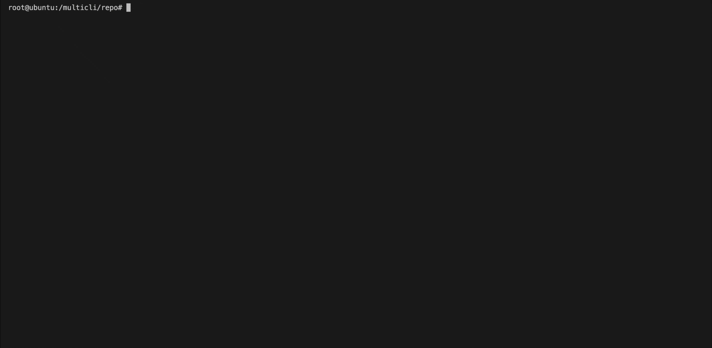
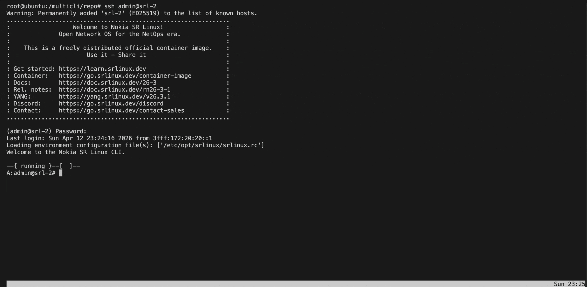

# MultiCLI Agent

Nokia SR Linux provides an NDK (NetOps Development Kit) that allows you to create custom applications and agents. Through gRPC services, custom applications can receive configuration and operational notifications from SR Linux applications and publish state back into the model-driven telemetry datastore. You can find the NDK `.proto` definitions at: https://github.com/nokia/srlinux-ndk-protobufs

In addition, SR Linux supports integrating a custom YANG data model for the application, providing full operational access through model-driven interfaces such as CLI, JSON-RPC, and gNMI. The MultiCLI Agent leverages these capabilities to streamline deploying custom CLI plugins from the MultiCLI project onto `/etc/opt/srlinux/cli` without manually copying files onto the router or overwriting third-party user plugins.

The MultiCLI Agent is supported on Nokia SR Linux 25.3.1 and later, built using [NDK v0.5.0](https://learn.srlinux.dev/ndk/releases/0.5/).

## Available Packages

Pre-built Debian packages follow standard Debian Policy naming (`<package>_<version>_<arch>.deb`):

- `ndk-agent/srl-multicli_0.2.0_amd64.deb` (x86_64 / AMD64)
- `ndk-agent/srl-multicli_0.2.0_arm64.deb` (ARM64 / AArch64)

## Installation

Clone the repository:
```bash
git clone https://github.com/srl-labs/multicli.git
```

Transfer the `.deb` package matching your router architecture (`amd64` or `arm64`):
```bash
scp multicli/ndk-agent/srl-multicli_0.2.0_arm64.deb admin@srl-2:.
```

On the SR Linux router, enable the NDK server:
```
/ system ndk-server admin-state enable
```

If pulling from GitHub or a hostname URL, ensure DNS server configuration is present in the management network instance:

SR Linux 25.X:
```
/ system dns server-list [ 1.1.1.1 8.8.8.8 ]
```

SR Linux 26.X (`clab-default` used as the DNS instance name in this example):
```
/ system dns-instance clab-default server-list [ 1.1.1.1 8.8.8.8 ] network-instance mgmt
```

Install the package from the SR Linux bash shell:
```
A:admin@srl-2# bash
admin@srl-2:~$ sudo dpkg -i srl-multicli_0.2.0_arm64.deb
Selecting previously unselected package srl-multicli.
(Reading database ... 40773 files and directories currently installed.)
Preparing to unpack srl-multicli_0.2.0_arm64.deb ...
Unpacking srl-multicli (0.2.0) ...
Setting up srl-multicli (0.2.0) ...
admin@srl-2:~$ exit
logout
```

Reload `app_mgr` to register and start the MultiCLI agent:
```
/ tools system app-management application app_mgr reload
```

Validate the agent status:
```
A:admin@srl-2# show system application multicli
  +----------+------+---------+---------+--------------------------+
  |   Name   | PID  |  State  | Version |       Last Change        |
  +==========+======+=========+=========+==========================+
  | multicli | 7219 | running | v0.2.0  | 2026-04-11T22:37:29.545Z |
  +----------+------+---------+---------+--------------------------+
```



## Configuration

Configure the target NOS persona and (optionally) a custom `.zip` archive URL:

- `enabled-nos`: `'nokia-sros'`, `'arista'`, `'cisco'`, `'juniper'`, `'all'` (enables all vendor submodes `eos`, `nxos`, `junos`, `sros` simultaneously while keeping root `show` native), or `'none'` (disables MultiCLI and removes MultiCLI-managed plugin files).
- `repo-url`: HTTP/HTTPS URL to a `.zip` archive containing the `arista`, `cisco-nx`, `juniper`, and `nokia` directories (defaults to `https://github.com/srl-labs/multicli/archive/refs/heads/main.zip`).

> **Safe Plugin Management**: MultiCLI tracks installed files in `/etc/opt/srlinux/cli/.multicli_manifest.json`. Existing user or third-party CLI plugins in `/etc/opt/srlinux/cli` are preserved across persona switches, disables, and configuration deletions. In addition, if downloading or validating a new archive fails, existing working MultiCLI plugins are left intact until a valid archive succeeds.

Example enabling Nokia SR OS commands from the default repository:
```
--{ !* candidate shared default }--[  ]--
A:admin@srl-2# / multicli enabled-nos nokia-sros
A:admin@srl-2# commit stay

--{ candidate shared default }--[  ]--
A:admin@srl-2# info detail multicli
    enabled-nos nokia-sros
    repo-url https://github.com/srl-labs/multicli/archive/refs/heads/main.zip
```

Verify operational state (`"No errors"` in `error-messages`):
```
A:admin@srl-2# info from state multicli
    enabled-nos nokia-sros
    repo-url https://github.com/srl-labs/multicli/archive/refs/heads/main.zip
    error-messages "No errors"
```

Re-login to open a new CLI session with the installed plugins:
```
A:admin@srl-2# show router bgp summary
===============================================================================
 BGP Router ID:10.10.10.2           AS:65500      Local AS:65500
===============================================================================
...
```

### Offline / Local HTTP Repository

For air-gapped or lab environments without internet access, host a `.zip` archive of the repository over HTTP reachable via the `mgmt` network instance:
```
/ multicli enabled-nos juniper
/ multicli repo-url http://172.20.10.1:8000/MultiCLI-main.zip
```

Verify state:
```
A:admin@srl-2# info from state multicli
    enabled-nos juniper
    repo-url http://172.20.10.1:8000/MultiCLI-main.zip
    error-messages "No errors"
```

If an invalid URL or corrupted archive is configured, the failure reason is reported in `error-messages` while preserving any previously installed plugins:
```
A:admin@srl-2# info from state multicli
    enabled-nos juniper
    repo-url http://172.20.10.4:8000/MultiCLI-main.zip
    error-messages "Verify DNS configuration and repository reachability via mgmt network-instance"
```

### Disabling or Removing MultiCLI Configuration

To disable MultiCLI plugins while keeping the `/multicli` configuration block:
```
/ multicli enabled-nos none
```

Or delete the `/multicli` presence container completely (which removes MultiCLI-managed plugin files and clears `/multicli` operational state):
```
delete / multicli
```



## Agent Management

Stopping the MultiCLI Agent:
```
A:admin@srl-2# / tools system app-management application multicli stop
/system/app-management/application[name=multicli]:
    Application 'multicli' was killed with signal 15 (SIGTERM)
```

Starting the MultiCLI Agent:
```
A:admin@srl-2# / tools system app-management application multicli start
/system/app-management/application[name=multicli]:
    Application 'multicli' was started
```

## Building Debian Packages from Source

The agent source tree lives in `ndk-agent/src/` and can be packaged with `ndk-agent/build-deb.sh`:

```bash
# Build .deb packages for both supported architectures (amd64 and arm64)
./ndk-agent/build-deb.sh

# Or build for a single architecture:
./ndk-agent/build-deb.sh amd64
./ndk-agent/build-deb.sh arm64
```

Generated packages (`srl-multicli_0.2.0_amd64.deb` and `srl-multicli_0.2.0_arm64.deb`) are written to `ndk-agent/`.
